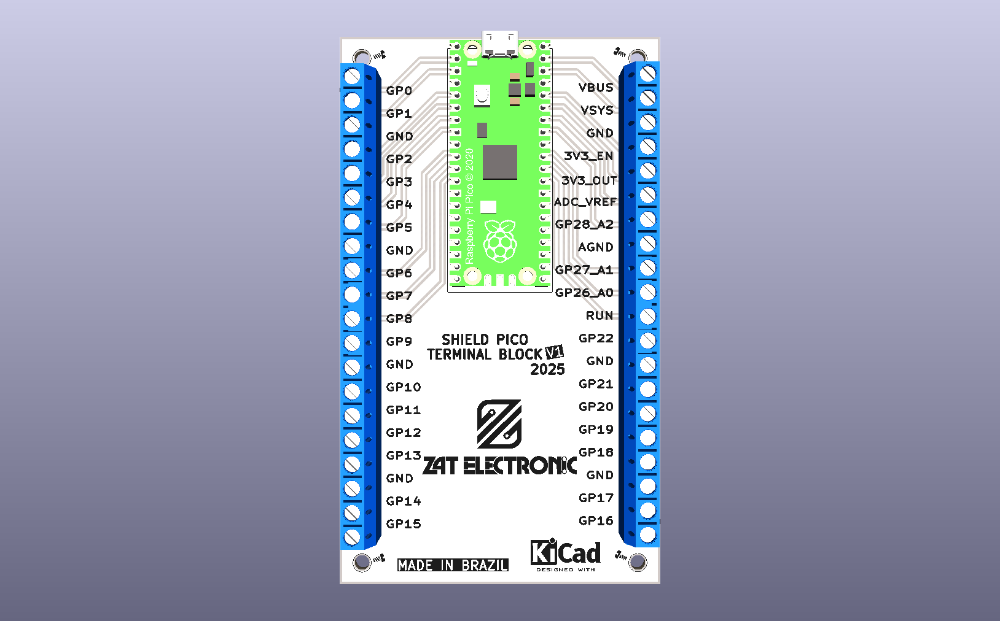
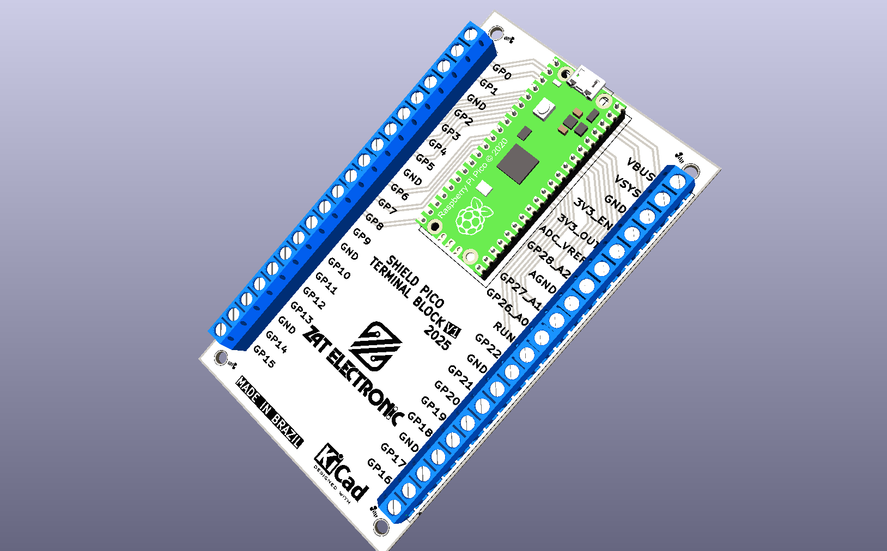

<div align="center">



# SHIELD PICO TERMINAL BLOCK V1

**Shield de expansão para Raspberry Pi Pico com todos os pinos expostos em bornes de parafuso KRE — conexão fácil e robusta sem solda de fios**

[](https://www.kicad.org/)
[](.)
[](.)
[](.)
[](.)
[](.)
[](.)

</div>

---

## 📋 Índice

- [SHIELD PICO TERMINAL BLOCK V1](#shield-pico-terminal-block-v1)
  - [📋 Índice](#-índice)
  - [Visão Geral](#visão-geral)
  - [Renders 3D](#renders-3d)
  - [Funcionalidades](#funcionalidades)
  - [Mapa Completo de Pinos](#mapa-completo-de-pinos)
    - [J1 — Borne Esquerdo (20 terminais)](#j1--borne-esquerdo-20-terminais)
    - [J2 — Borne Direito (20 terminais)](#j2--borne-direito-20-terminais)
  - [Especificações Técnicas](#especificações-técnicas)
  - [Lista de Materiais](#lista-de-materiais)
  - [Aplicações](#aplicações)
  - [Estrutura do Repositório](#estrutura-do-repositório)
  - [Como Usar](#como-usar)
    - [Instalação](#instalação)
    - [Alimentação](#alimentação)
    - [Exemplo — Piscar LED interno com MicroPython](#exemplo--piscar-led-interno-com-micropython)
    - [Exemplo — Leitura analógica (GP26\_A0)](#exemplo--leitura-analógica-gp26_a0)
    - [Exemplo — I2C com MicroPython](#exemplo--i2c-com-micropython)
    - [Fixação em painel](#fixação-em-painel)
  - [Sobre](#sobre)

---

## Visão Geral

**SHIELD PICO TERMINAL BLOCK V1** é uma placa de expansão para o **Raspberry Pi Pico (RP2040)**, projetada pela **ZAT ELECTRONIC** utilizando **KiCad 10**. O shield encaixa o Raspberry Pi Pico em dois conectores fêmea de 20 pinos e expõe **todos os 40 pinos** do Pico em **dois bornes de parafuso KRE de 20 terminais cada** — um em cada lateral da placa.

O objetivo é simples e prático: eliminar a necessidade de soldar fios diretamente ao Pico, proporcionando **conexões robustas por parafuso** ideais para prototipagem, automação, laboratório e projetos onde os fios precisam ser trocados com frequência.

> 💡 Todos os pinos do Raspberry Pi Pico são acessíveis diretamente pelos bornes — GP0 a GP28, entradas analógicas A0–A2, alimentações VBUS, VSYS, 3V3, GND, ADC_VREF, AGND, 3V3_EN e RUN.

---

## Renders 3D

<div align="center">


*Vista superior — Raspberry Pi Pico encaixado, bornes KRE nas laterais com serigrafias de todos os pinos*

<br/>



*Vista isométrica — bornes de 20 terminais em cada lado e 4 furos de fixação*

</div>

---

## Funcionalidades

- ✅ **Raspberry Pi Pico (RP2040)** — encaixe via 2 conectores fêmea de 20 pinos 2,54mm
- ✅ **Borne KRE J1** — 20 terminais parafuso, lado esquerdo (GP0–GP15 + GNDs)
- ✅ **Borne KRE J2** — 20 terminais parafuso, lado direito (GP16–GP28 + alimentações)
- ✅ **Todos os 40 pinos expostos** — GPIO, analógicos, alimentação e controle
- ✅ **Pinos de alimentação acessíveis** — VBUS, VSYS, 3V3_OUT, 3V3_EN, ADC_VREF, AGND
- ✅ **Pino RUN acessível** — reset externo do Pico por borne
- ✅ **4 furos de fixação** (H1–H4) — montagem em painel ou caixa
- ✅ **Serigrafias completas** — nome de cada pino impresso ao lado do borne correspondente
- ✅ **Sem componentes adicionais** — shield passivo de conexão pura
- ✅ **Made in Brazil** — serigrafia na PCB

---

## Mapa Completo de Pinos

### J1 — Borne Esquerdo (20 terminais)

| Terminal | Pino Pico | Função |
|----------|-----------|--------|
| 1 | GP0 | GPIO / UART0 TX / SPI0 RX / I2C0 SDA / PWM0A |
| 2 | GP1 | GPIO / UART0 RX / SPI0 CSn / I2C0 SCL / PWM0B |
| 3 | GND | Terra |
| 4 | GP2 | GPIO / SPI0 SCK / I2C1 SDA / PWM1A |
| 5 | GP3 | GPIO / SPI0 TX / I2C1 SCL / PWM1B |
| 6 | GP4 | GPIO / UART1 TX / SPI0 RX / I2C0 SDA / PWM2A |
| 7 | GP5 | GPIO / UART1 RX / SPI0 CSn / I2C0 SCL / PWM2B |
| 8 | GND | Terra |
| 9 | GP6 | GPIO / SPI0 SCK / I2C1 SDA / PWM3A |
| 10 | GP7 | GPIO / SPI0 TX / I2C1 SCL / PWM3B |
| 11 | GP8 | GPIO / UART1 TX / SPI1 RX / I2C0 SDA / PWM4A |
| 12 | GP9 | GPIO / UART1 RX / SPI1 CSn / I2C0 SCL / PWM4B |
| 13 | GND | Terra |
| 14 | GP10 | GPIO / SPI1 SCK / I2C1 SDA / PWM5A |
| 15 | GP11 | GPIO / SPI1 TX / I2C1 SCL / PWM5B |
| 16 | GP12 | GPIO / SPI1 RX / I2C0 SDA / PWM6A |
| 17 | GP13 | GPIO / SPI1 CSn / I2C0 SCL / PWM6B |
| 18 | GND | Terra |
| 19 | GP14 | GPIO / SPI1 SCK / I2C1 SDA / PWM7A |
| 20 | GP15 | GPIO / SPI1 TX / I2C1 SCL / PWM7B |

### J2 — Borne Direito (20 terminais)

| Terminal | Pino Pico | Função |
|----------|-----------|--------|
| 1 | VBUS | 5V USB (do conector micro-USB do Pico) |
| 2 | VSYS | Tensão de entrada do sistema (1,8V–5,5V) |
| 3 | GND | Terra |
| 4 | 3V3_EN | Habilita regulador 3,3V interno |
| 5 | 3V3_OUT | Saída 3,3V regulada (até 300mA) |
| 6 | ADC_VREF | Referência de tensão para ADC |
| 7 | GP28_A2 | GPIO / ADC canal 2 |
| 8 | AGND | Terra analógico |
| 9 | GP27_A1 | GPIO / ADC canal 1 / I2C1 SCL |
| 10 | GP26_A0 | GPIO / ADC canal 0 / I2C1 SDA |
| 11 | RUN | Reset externo (ativo em LOW) |
| 12 | GP22 | GPIO / PWM |
| 13 | GND | Terra |
| 14 | GP21 | GPIO / I2C0 SCL / PWM |
| 15 | GP20 | GPIO / I2C0 SDA / PWM |
| 16 | GP19 | GPIO / SPI0 TX / I2C1 SCL / PWM |
| 17 | GP18 | GPIO / SPI0 SCK / I2C1 SDA / PWM |
| 18 | GND | Terra |
| 19 | GP17 | GPIO / UART0 RX / SPI0 CSn / I2C0 SCL / PWM |
| 20 | GP16 | GPIO / UART0 TX / SPI0 RX / I2C0 SDA / PWM |

---

## Especificações Técnicas

| Parâmetro | Valor |
|-----------|-------|
| **Microcontrolador suportado** | Raspberry Pi Pico (RP2040) |
| **Conectores do Pico** | 2x fêmea 20 pinos 2,54mm |
| **Bornes de parafuso** | 2x KRE 20 pinos, passo 5,0mm |
| **Total de terminais** | 40 (todos os pinos do Pico) |
| **Furos de fixação** | 4x (H1–H4) |
| **Componentes ativos** | Nenhum — shield passivo |
| **Ferramenta de Projeto** | KiCad 10 |
| **Versão** | V1 — 2025 |

---

## Lista de Materiais

| Ref | Componente | Valor / Parte | Encapsulamento |
|-----|-----------|--------------|----------------|
| U1 | Raspberry Pi Pico | RP2040 | Módulo — encaixe fêmea 2×20 pinos |
| J1 | Borne Esquerdo | 20 terminais parafuso | KRE 20 pinos, passo 5,0mm |
| J2 | Borne Direito | 20 terminais parafuso | KRE 20 pinos, passo 5,0mm |
| H1–H4 | Furos de Fixação | M3 | MountingHole |

---

## Aplicações

- 🤖 **Automação e controle** — conexão rápida de sensores, atuadores e módulos
- 🏭 **Protótipos industriais** — terminais parafuso para ambientes com vibração
- 🔬 **Laboratório e bancada** — troca rápida de fios sem dessoldagem
- 🏠 **Automação residencial** — integração com relés, sensores e periféricos
- 📡 **IoT com MicroPython** — acesso fácil a todos os pinos para projetos IoT
- 🎓 **Ensino e aprendizado** — plataforma didática para explorar o Raspberry Pi Pico
- 🔧 **Desenvolvimento embarcado** — prototipagem ágil com conexões seguras

---

## Estrutura do Repositório

```
SHIELD_PICO_TERMINAL_BLOCK/
├── SHIELD_PICO_TERMINAL_BLOCK.kicad_pro   # Arquivo de projeto KiCad
├── SHIELD_PICO_TERMINAL_BLOCK.kicad_sch   # Esquemático (KiCad 10)
├── SHIELD_PICO_TERMINAL_BLOCK.kicad_pcb   # Layout da PCB (KiCad 10)
├── SHIELD_PICO_TERMINAL_BLOCK.kicad_prl   # Configurações locais
├── packages3D/                            # Modelos 3D arquivados
│   ├── raspberry pi pico with contacts.step
│   ├── 20-Pin Header - Female - 2.54mm.step
│   └── DG306-5.0-20P-12-00AH.STEP
├── fp-info-cache                          # Cache de footprints
├── imagem_1.png                           # Render 3D superior
├── imagem_2.png                           # Render 3D isométrico
└── README.md
```

---

## Como Usar

### Instalação

1. Encaixe o **Raspberry Pi Pico** nos dois conectores fêmea de 20 pinos do shield
2. Certifique-se de que o Pico está bem assentado e alinhado
3. Conecte os fios nos bornes de parafuso desejados, apertando o parafuso com chave de fenda

### Alimentação

| Método | Conexão |
|--------|---------|
| **Via USB do Pico** | Conecte o cabo micro-USB diretamente ao Pico |
| **Via VSYS** | Aplique 1,8V–5,5V no terminal VSYS do borne J2 |
| **Via VBUS** | Aplique 5V no terminal VBUS do borne J2 |

### Exemplo — Piscar LED interno com MicroPython

```python
from machine import Pin
from time import sleep

led = Pin(25, Pin.OUT)  # LED interno do Pico (GP25)

while True:
    led.toggle()
    sleep(0.5)
```

### Exemplo — Leitura analógica (GP26_A0)

```python
from machine import ADC
from time import sleep

adc = ADC(26)  # GP26 = ADC canal 0 (terminal J2 — GP26_A0)

while True:
    valor = adc.read_u16()
    tensao = valor * 3.3 / 65535
    print(f"ADC: {valor} | Tensão: {tensao:.2f}V")
    sleep(0.5)
```

### Exemplo — I2C com MicroPython

```python
from machine import I2C, Pin

# I2C0 em GP0 (SDA) e GP1 (SCL) — terminais J1
i2c = I2C(0, sda=Pin(0), scl=Pin(1), freq=400000)
dispositivos = i2c.scan()
print("Dispositivos I2C encontrados:", [hex(d) for d in dispositivos])
```

### Fixação em painel

> 🔧 Utilize os 4 furos de fixação (H1–H4) com parafusos M3 para montar o shield em painéis, trilhos DIN (com adaptador) ou caixas de projeto.

---

## Sobre

<div align="center">

Projetado por **ZAT ELECTRONIC**

*SHIELD PICO TERMINAL BLOCK V1 — 2025 — Made in Brazil 🇧🇷*

[](https://www.kicad.org/)
[](https://www.oshwa.org/)

</div>